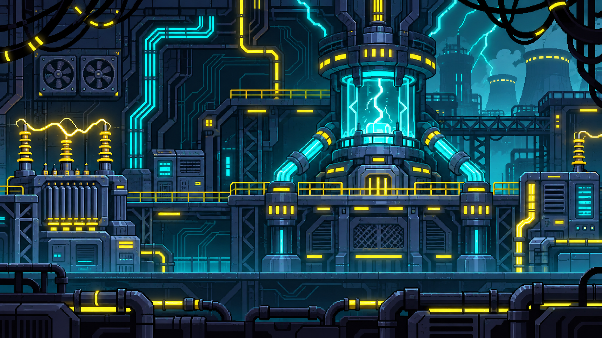
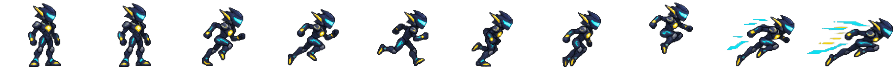

# ⚡ VOLTIX (Demo v1.0)

Plataformero 2D de acción y alto voltaje desarrollado con **Phaser 3**, **Vite** y **Electron** para **Linux**.

Controlá a **Voltix**, recolectá las células de voltaje en 4 sectores de prueba y activá el portal de salida esquivando pilones Tesla, drones de seguridad, centinelas y cazadores.

---

## 🎮 Vista previa



| Personaje | Sprite Sheet (10 poses) |
| :---: | :---: |
| **Voltix** |  |

---

## ✨ Características (Modo Prueba — 4 Sectores)

- **Movimiento 2D fluido**: correr, saltar, **salto doble**, *coyote time*, *jump buffer* y **dash eléctrico** con estela de partículas.
- **4 sectores progresivos**: *Acceso*, *Núcleo*, *Escape Final* y *Núcleo Central*.
- **3 tipos de enemigos**:
  - **Drones**: patrulla horizontal.
  - **Centinelas**: patrulla vertical.
  - **Cazadores**: patrullan y aceleran hacia vos cuando te acercás.
- **Audio procedural**: efectos de sonido generados con Web Audio API (sin archivos externos).
- **Récords locales**: guarda tu mayor puntaje en voltios y mejor tiempo en `localStorage`.
- **Empaquetado nativo para Linux**: genera un ejecutable `.AppImage` listo para abrir con doble clic.

---

## 🕹️ Controles

| Tecla | Acción |
| :--- | :--- |
| `←` / `→` | Moverse |
| `↑` o `Espacio` | Saltar / Salto doble |
| `Shift` | Dash eléctrico |
| `P` o `Esc` | Pausar / Reanudar |
| `M` | Activar / Silenciar sonido |
| `R` | Reiniciar sector |

---

## 🚀 Instalación y ejecución en Linux

```bash
# Clonar el repositorio
git clone https://github.com/BACB14/Voltix.git
cd Voltix

# Instalar dependencias
npm install

# Ejecutar en ventana nativa (Electron)
npm run electron

# Generar ejecutable .AppImage en release/
npm run build:linux
```

Para desarrollo rápido en navegador:
```bash
npm run dev
```

---

## 📁 Estructura del proyecto

```text
├── electron/          # Proceso principal de Electron y hook AppImage
├── public/assets/     # Fondo y spritesheet de Voltix
├── src/
│   ├── audio/         # Efectos de sonido procedurales (Web Audio API)
│   ├── entities/      # Player, Drone, Sentinel, Hunter
│   ├── graphics/      # Texturas procedurales neón/circuito
│   ├── levels/        # Definición de los 4 sectores
│   └── scenes/        # MenuScene y GameScene
├── index.html
├── package.json
└── vite.config.js
```
